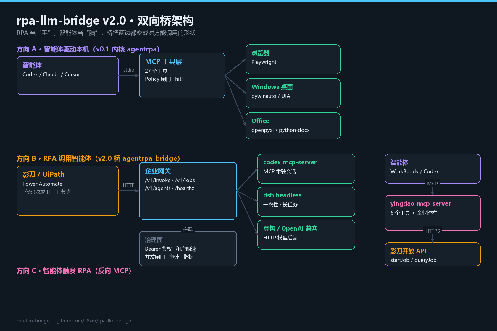
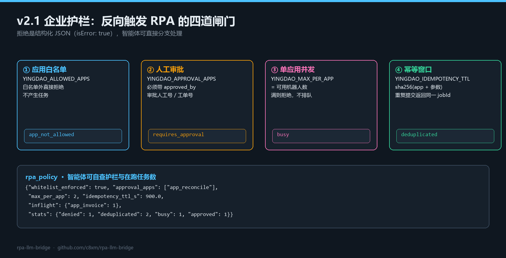

# rpa-llm-bridge

**企业 RPA 与智能体之间的双向桥。** 一套仓库，两个方向：

- **v0.1 内核（`agentrpa`）**：智能体通过 MCP 驱动浏览器 / Windows 桌面 / Office，统一 action 契约、YAML Recipe、Policy 闸门、hitl 暂停、断点续跑、审计。
- **v2.0 桥（`agentrpa_bridge`）**：影刀 / UiPath / Power Automate 反过来调用 Codex / Claude / DeepSeek Harness / 豆包，凭证托管、进程复用、并发闸门、限速、审计、指标；同时把影刀应用注册成 MCP 工具给智能体调用。

[](https://github.com/c8xm/rpa-llm-bridge/actions/workflows/ci.yml)

[](LICENSE)


📖 **[详细使用说明（USAGE.md）](docs/USAGE.md)** · 🏢 **[企业接入方案](docs/ENTERPRISE-ADOPTION.md)** · 🧭 **[平台接入对照（PLATFORMS.md）](docs/PLATFORMS.md)** · 🧱 **[设计取舍](docs/BRIDGE_DESIGN.md)**

---

## 架构



```
方向 A：智能体 → 电脑（v0.1）
  Codex / Claude / Cursor ──MCP──▶ 浏览器(Playwright) · Windows 桌面(pywinauto) · Office(openpyxl/docx)

方向 B：RPA → 智能体（v2.0）
  影刀 / UiPath / Power Automate
        │  sdk/rpa_agent_block.py（零依赖，可粘进代码块）或 HTTP
        ▼
  agentrpa-bridge gateway   鉴权 · 并发 · 限速 · 审计 · /metrics · 异步任务
        ├── stdio MCP ──▶ codex mcp-server / claude mcp serve / 自研 MCP
        ├── CLI      ──▶ dsh headless（DeepSeek Harness）
        └── HTTP     ──▶ 豆包（火山方舟）/ DeepSeek / vLLM / 私有网关

方向 C：智能体 → RPA（v2.0 反向）
  Codex / Claude / WorkBuddy ──MCP──▶ yingdao_mcp_server.py ──▶ 影刀 startJob / queryJob
```

企业里的分工：**RPA 当"手"，智能体当"脑"，桥负责把两边都变成对方能调用的形状，并把凭证、并发、审计、超时集中管住。**

## v2.0 新增

| 能力 | 说明 |
|---|---|
| 企业网关 | `POST /v1/invoke`、`POST /v1/jobs`、`/v1/agents`、`/healthz`、`/metrics`；Bearer 鉴权、per-tenant 限速、并发信号量、排队超时 503 |
| 后端适配 | Codex（MCP，常驻会话）、Claude Code（工具面）、dsh headless（一次性长任务）、豆包/火山方舟、任意 OpenAI 兼容、自研 MCP |
| 影刀 SDK | `sdk/rpa_agent_block.py` 单文件、Python 3.8+、零依赖；自动在"网关模式"与"本地 stdio"之间切换 |
| 反向 MCP | `agentrpa_bridge/yingdao_mcp_server.py` 暴露 `rpa_list_apps / rpa_app_params / rpa_start_job / rpa_query_job / rpa_clients` |
| 配置导出 | `scripts/export_mcp_config.py` 幂等写入 WorkBuddy / Claude / Cursor，并打印 Codex TOML |
| 审计与指标 | jsonl（prompt 指纹 + 前 200 字符 + 密钥正则脱敏）、Prometheus 文本指标 |

### v2.1 新增：企业护栏



反向触发 RPA 属于对内部系统的写操作，比模型调用更需要按"应用"维度管：

| 护栏 | 变量 | 行为 |
|---|---|---|
| 应用白名单 | `YINGDAO_ALLOWED_APPS` | 白名单外直接拒绝，不产生任务 |
| 人工审批 | `YINGDAO_APPROVAL_APPS` | 必须带 `approved_by`，否则 `requires_approval` |
| 单应用并发 | `YINGDAO_MAX_PER_APP` | 满则 `busy`，不排队、不堆积 |
| 幂等窗口 | `YINGDAO_IDEMPOTENCY_TTL` | 同参重复提交返回同一 `jobId`，不会重复跑 |

新增 `rpa_policy` 工具，智能体可自行查看护栏状态与在跑任务数。落地路径（角色、四阶段、评审问答、验收清单）见 [企业接入方案](docs/ENTERPRISE-ADOPTION.md)。

### v2.2 新增：安全与稳定性加固

一轮"按能不能上线"标准的自审，修掉 5 个已被复现的边界问题（详见 [Release v2.2.0](https://github.com/c8xm/rpa-llm-bridge/releases/tag/v2.2.0)）：

| 问题 | 修法 |
|---|---|
| 没配 token 时任意 Bearer 都放行 | 常量时间逐个比对，未知 token 一律 401 |
| 超限 body 打断 keep-alive 连接 | 丢弃 body + `Connection: close` + 明码 413 |
| 同一 agent 的串行锁不受 timeout 约束 | 锁等待按调用方预算超时，返回 `busy` |
| 超时被当成可重试错误 | 超时不再重试，只对进程崩溃重连一次 |
| 审计只脱敏 key，不脱敏 PII | 手机 / 身份证 / 银行卡 / 邮箱统一打码 |

另外：`AGENTRPA_ALLOW_ANON` 默认改为 `0`；RPA 并发槽位加 `YINGDAO_MAX_HOLD` 自动回收；wheel 补发 `server.py` 与影刀 SDK。

### v2.3 新增：调用幂等 + 参数注入防护

| 能力 | 用法 | 行为 |
|---|---|---|
| 幂等调用 | `Idempotency-Key: <业务单号>` | 同 key 在窗口内只跑一次 agent，重复请求直接回放结果（`idempotent_replay: true`），并发重复请求返回 409 |
| 参数转义 | 自动生效 | Windows `.cmd` shim 的 `& \| < > ^ ( )` 统一转义，prompt 里的 `& calc` 不会变成第二条命令 |

```powershell
curl -s -X POST http://127.0.0.1:8765/v1/invoke `
  -H "Authorization: Bearer tok-a" -H "Idempotency-Key: order-88123" `
  -H "Content-Type: application/json" `
  -d '{"agent":"codex","prompt":"……"}'
```

### v2.4 新增：跨节点共享状态

限速与幂等不再困在单个进程里：

```powershell
$env:AGENTRPA_STATE_BACKEND = "sqlite"
$env:AGENTRPA_STATE_PATH    = "D:\bridge\state.db"
```

| 后端 | 适用 |
|---|---|
| `memory`（默认） | 单进程 / PoC |
| `sqlite` | 同机多进程、共享盘；WAL + `BEGIN IMMEDIATE` 保证跨进程一致 |
| Redis | 未内置，按 `store.py` 的 4 个方法实现即可 |

两个网关共用一个库时，同一个 `Idempotency-Key` 只会跑一次 agent（有用例锁死）。

### v2.5 新增：SSE 进度流

长任务不再只有一个「转圈」：

```powershell
curl -N "http://127.0.0.1:8765/v1/jobs/$run_id/events" -H "Authorization: Bearer tok-a"
```

```text
event: progress
data: {"stage": "tool_call", "name": "read_file", "seq": 3}
```

| 能力 | 说明 |
|---|---|
| 事件流 | `GET /v1/jobs/{id}/events`，`queued → running → text → tool_call → final → succeeded` |
| 断点续传 | `Last-Event-ID` 头或 `?since=N`，重连不重复、不丢 |
| 真实事件 | CLI 参数带 `--json`（如 `dsh headless --json -`）时逐行解析；MCP 后端给两个生命周期节点 |
| 影刀侧 | `ab.ask_agent_stream(prompt, on_event=...)`，回调里写变量 |

## 快速开始

### 只跑桥（零第三方依赖）

```powershell
git clone https://github.com/c8xm/rpa-llm-bridge.git
cd rpa-llm-bridge
python examples\local_demo.py                       # 不需要任何 API key
python -m unittest tests.test_mcp_client tests.test_providers tests.test_gateway tests.test_sdk tests.test_yingdao tests.test_platforms
```

起网关：

```powershell
$env:AGENTRPA_TOKENS = "tenantA:tok-a"
$env:AGENTRPA_ALLOW_ANON = "0"
python -m agentrpa_bridge.gateway --port 8765
```

调一次：

```powershell
curl -s -X POST http://127.0.0.1:8765/v1/invoke `
  -H "Authorization: Bearer tok-a" -H "Content-Type: application/json" `
  -d '{"agent":"codex","prompt":"把 11300 含税金额按 13% 拆出税额，只返回数字","meta":{"flow":"invoice_tax"}}'
```

### 跑内核（智能体操作本机）

```powershell
python -m venv .venv
.\.venv\Scripts\python.exe -m pip install -e ".[dev]"
.\.venv\Scripts\python.exe -m playwright install chromium
.\.venv\Scripts\python.exe server.py
```

## 后端怎么选

| 场景 | `agent` | 形态 | 单次耗时 |
|---|---|---|---|
| 改脚本、跑命令、要工具 | `codex` | MCP 常驻 | 3–15 s |
| 长任务（分钟级） | `dsh` | CLI 一次性 | 冷启动 2–5 s + 任务 |
| 中文文本生成、量大 | `doubao` | OpenAI 兼容 | 1–8 s |
| 模型在本机动手 | `claude` | MCP 工具面 | 取决于工具 |
| 离线/私有模型 | `llm` | OpenAI 兼容 | 取决于部署 |

接法与坑见 [PLATFORMS.md](docs/PLATFORMS.md)：WorkBuddy 是 MCP 客户端而非后端；`claude mcp serve` 是工具集合不是问答；豆包 `model` 必须填接入点 `ep-...`；dsh 只读 `.env` 里的凭据。

## 工具清单

v0.1 内核（27 个 MCP 工具，详见 [USAGE.md](docs/USAGE.md)）：`server_info` / `policy_summary` / `driver_status` / `browser_*` / `open_url` / `page_snapshot` / `list_page_elements` / `click_page_element` / `type_into_element` / `scroll_page` / `take_screenshot` / `extract_page` / `recipe_list|get|run` / `run_state|resume|list` / `audit_tail` / `desktop_*` / `office_*`

v2.0 反向（影刀）：`rpa_list_apps` / `rpa_app_params` / `rpa_start_job` / `rpa_query_job` / `rpa_clients` / `rpa_run_local` / `rpa_policy`

## 项目结构

```text
rpa-llm-bridge/
├─ server.py                 v0.1 MCP 工具层
├─ agentrpa/                 v0.1 内核：core / drivers / recipes
├─ agentrpa_bridge/          v2.0 桥
│  ├─ mcp_client.py          最小 MCP stdio 客户端（纯 stdlib）
│  ├─ providers.py           codex / claude / dsh / 豆包 / OpenAI / CLI + 会话池
│  ├─ gateway.py             企业网关（鉴权·并发·限速·审计·指标·异步）
│  ├─ yingdao_api.py         影刀开放 API（签名可替换）+ 本地 ShadowBot
│  ├─ policy.py              企业护栏：白名单 / 审批 / 单应用并发 / 幂等
│  └─ yingdao_mcp_server.py  反向 MCP：RPA 应用作为工具
├─ sdk/rpa_agent_block.py    影刀代码块单文件 SDK（3.8+）
├─ scripts/                  export_mcp_config.py / install_windows.ps1 / make_assets.py
├─ examples/                 local_demo.py（RPA 调智能体）/ reverse_demo.py（智能体调 RPA）
│                            mock_yingdao_server.py（没有影刀环境时的假开放 API）
├─ tests/                    143 个用例（内核 43 + 桥 51 + 反方向 5 + 护栏 11 + 加固 10 + 幂等/转义 11 + 共享状态 7 + 进度流 5）
└─ docs/                     USAGE.md / ENTERPRISE-ADOPTION.md / PLATFORMS.md / BRIDGE_DESIGN.md / DESIGN.md
```

## 安全模型

1. **凭证分层**：工位只有网关 token；模型 key 只存网关机；影刀 AccessKey 只存反向 MCP 进程。
2. **审计脱敏**：`prompt` 只留前 200 字符 + sha256；`sk-*` / `ghp_*` / `AKIA*` / `Bearer *` 统一 `[REDACTED]`。
3. **配额与背压**：默认 60 req/min/tenant、4 并发；打满排队超时回 503，不无限堆积。
4. **不可逆动作不外包**：下单、支付、发布、删除仍留在 RPA 的审批节点，桥不提供"agent 直接确认"的通道。
5. **v0.1 的 Policy 闸门照旧**：域名白名单、应用白名单、敏感字段拦截、状态变更人工确认。

## 路线图

- [x] v0.1 多驱动内核（浏览器 / 桌面 / Office）
- [x] v2.0 企业网关 + 影刀 SDK + 反向 MCP + 多后端适配
- [ ] `dsh headless --json` 事件流 → 网关 SSE 进度接口
- [ ] 同名多实例调度（`codex-1..N`）与按工单 hash 分片
- [ ] 审计按 run 聚合查询与导出
- [ ] 录制回放：一次人工操作转成 Recipe 草稿
- [ ] 桌面控件截图回归

## 许可

MIT © 2026 c8xm。架构思路参考 [JD-Taobao-MCP](https://github.com/HaonanYu123/JD-Taobao-MCP)，代码为独立实现，来源记录见 [UPSTREAM.md](UPSTREAM.md)。
