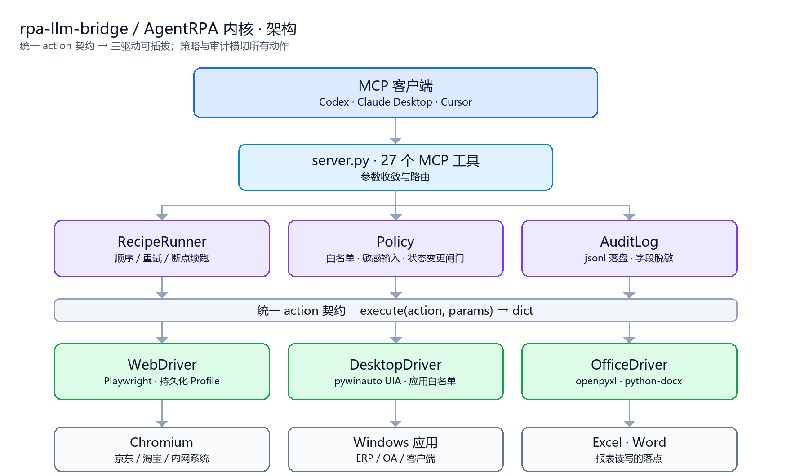
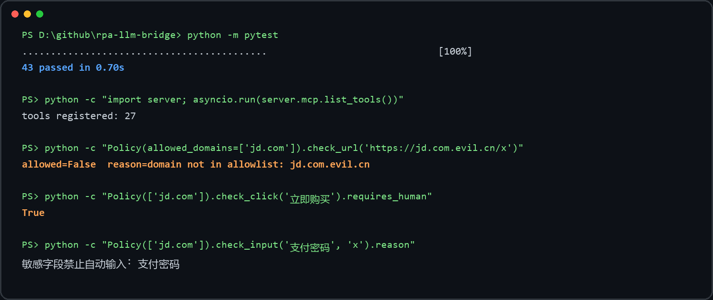

# rpa-llm-bridge

**把 LLM 接到 RPA 上**：一套统一的 action 契约，同时驱动浏览器、Windows 桌面应用和 Office 文件；用 YAML 描述流程，用策略闸门管住不可逆动作，用审计日志留下每一步的痕迹。

内核代号 `AgentRPA`，Python 包名 `agentrpa`。

通过 [MCP](https://modelcontextprotocol.io) 暴露给 Codex / Claude Desktop / Cursor 等客户端，让模型能真正"操作"本机软件，而不是只会说。

[](https://github.com/c8xm/rpa-llm-bridge/actions/workflows/ci.yml)
[](LICENSE)
[](pyproject.toml)

---

## 这个项目和"电商采集器"有什么不同

多数 RPA 项目只覆盖一个网站、一种交互。AgentRPA 把差异抽到三层里：

| 维度 | 单站点采集器 | AgentRPA |
|---|---|---|
| 作用域 | 一个网站 | 浏览器 / 桌面应用 / Office 文件 |
| 流程定义 | 写死在代码里 | YAML Recipe，可 diff、可版本化、可参数化 |
| 安全边界 | 分散在各函数里 | 集中式 `Policy`，所有驱动共用 |
| 不可逆动作 | 靠自觉 | 默认拦截 + 人工确认 + 断点续跑 |
| 可追溯性 | 打日志了事 | 结构化审计 jsonl，敏感字段强制脱敏 |
| 失败恢复 | 重跑整个脚本 | run 状态落盘，`run_resume` 从暂停点继续 |

## 架构



三个核心概念：

- **Driver**：实现 `BaseDriver.execute(action, params)`。新增一种被控端 = 新增一个驱动，执行器与策略层零改动。
- **Recipe**：YAML 声明的步骤序列。步骤可声明 `hitl: true` 强制人工确认，可声明 `on_error: skip|retry|abort`。
- **Policy**：唯一的安全判定点。域名白名单、应用白名单、敏感字段拦截、状态变更闸门都在这里，驱动不许自己另立标准。

## 快速开始

要求 Windows 10/11（桌面驱动）/ macOS·Linux（浏览器与 Office 驱动）、Python 3.11+。

```powershell
git clone https://github.com/c8xm/rpa-llm-bridge.git
cd rpa-llm-bridge
python -m venv .venv
.\.venv\Scripts\python.exe -m pip install -U pip
.\.venv\Scripts\python.exe -m pip install -e ".[dev]"
.\.venv\Scripts\python.exe -m playwright install chromium
Copy-Item .env.example .env
```

启动（stdio 模式会被客户端拉起，直接运行会停在等待状态）：

```powershell
.\.venv\Scripts\python.exe server.py
```

## MCP 客户端配置

Codex（`%USERPROFILE%\.codex\config.toml`）：

```toml
[mcp_servers.agentrpa]
command = "<PROJECT_DIR>/.venv/Scripts/python.exe"
args = ["<PROJECT_DIR>/server.py"]
cwd = "<PROJECT_DIR>"
enabled = true
startup_timeout_sec = 30
tool_timeout_sec = 180

[mcp_servers.agentrpa.env]
PLAYWRIGHT_HEADLESS = "false"
ALLOW_STATE_CHANGING_ACTIONS = "false"
ALLOWED_DOMAINS = "jd.com,taobao.com,tmall.com"
```

Cursor / Claude Desktop（JSON）：

```json
{
  "mcpServers": {
    "agentrpa": {
      "command": "<PROJECT_DIR>\\.venv\\Scripts\\python.exe",
      "args": ["<PROJECT_DIR>\\server.py"],
      "env": {
        "PLAYWRIGHT_HEADLESS": "false",
        "ALLOW_STATE_CHANGING_ACTIONS": "false",
        "ALLOWED_DOMAINS": "jd.com,taobao.com,tmall.com"
      }
    }
  }
}
```

## 内置流程

| Recipe | 场景 | 驱动 | 说明 |
|---|---|---|---|
| `ecom_collect` | 电商信息采集 | browser | 打开搜索页，抽取标题与价格，附页面快照 |
| `web_form` | 通用网页 RPA | browser | 填普通字段，提交前强制人工确认 |
| `desktop_erp` | 桌面 ERP 录入 | desktop | 启动客户端、定位窗口、填单据、读回显 |
| `office_report` | 企业报表 | office | 读源表、写汇总表 |
| `social_publish` | 内容平台运营 | browser | 填草稿、截图预览，发布动作人工确认 |

自定义流程只要往 `agentrpa/recipes/examples/` 丢一个 YAML：

```yaml
name: my_flow
description: 我的流程
driver: browser
vars:
  target: "https://example.com"
steps:
  - id: open
    action: navigate
    url: "{{target}}"
  - id: grab
    action: extract
    multi:
      titles: "h2"
    limit: 10
```

## 工具清单

| 工具 | 作用 |
|---|---|
| `server_info` | 版本、驱动能力、策略摘要、目录 |
| `policy_summary` | 白名单与拦截规则 |
| `driver_status` | 三个驱动的健康检查 |
| `browser_start` / `browser_status` / `browser_close` | 浏览器生命周期 |
| `open_url` | 打开白名单域名 URL |
| `page_snapshot` | 标题、正文摘要、链接、表单、meta |
| `list_page_elements` | 列出可交互元素并分配短期 ref |
| `click_page_element` | 点击元素（命中交易类文案会被拦截） |
| `type_into_element` | 写普通输入框（敏感字段拒绝） |
| `scroll_page` / `take_screenshot` / `extract_page` | 滚动、截图、按选择器批量抽取 |
| `recipe_list` / `recipe_get` / `recipe_run` | 流程发现与执行 |
| `run_state` / `run_resume` / `run_list` | 断点查看与人工批准后继续 |
| `audit_tail` | 审计日志（已脱敏） |
| `desktop_windows` / `desktop_focus` / `desktop_elements` | 桌面窗口与控件 |
| `office_sheets` / `office_read` / `office_write` | Excel / Word 读写 |

## 安全模型

1. **域名白名单**：`ALLOWED_DOMAINS` 之外一律拒绝，含同形域名（`jd.com.evil.cn`）。
2. **应用白名单**：桌面驱动在 `ALLOWED_APPS` 为空时拒绝启动任何进程。
3. **敏感字段**：密码、验证码、OTP、银行卡、CVV、身份证等标签直接拒绝输入，审计日志同步脱敏。
4. **状态变更闸门**：购买、支付、下单、发布、发送、删除等动作默认拦截；需要人工确认时流程停在 `awaiting_human`，由人决定是否 `run_resume`。
5. **不注入、不伪造**：不往页面里注入反检测脚本，不伪造浏览器指纹，不绕过验证码与风控。
6. **可追溯**：每一步的 action、判定结果、耗时都落到 `artifacts/audit/<date>.jsonl`。

## 项目结构

```text
rpa-llm-bridge/
├─ server.py                      MCP 工具入口
├─ agentrpa/
│  ├─ config.py                   环境变量配置
│  ├─ core/
│  │  ├─ types.py                 Step / StepResult / RunResult / Decision
│  │  ├─ policy.py                白名单与闸门
│  │  ├─ runner.py                执行器与断点续跑
│  │  ├─ audit.py                 审计日志与脱敏
│  │  └─ registry.py              驱动注册表
│  ├─ drivers/
│  │  ├─ base.py                  统一 action 契约
│  │  ├─ web.py                   Playwright 驱动
│  │  ├─ desktop.py               pywinauto 驱动
│  │  └─ office.py                Excel / Word 驱动
│  └─ recipes/
│     ├─ loader.py                YAML 校验与模板渲染
│     └─ examples/*.yaml          五个场景示例
├─ tests/                         43 个单元测试，不需要打开浏览器
├─ docs/DESIGN.md                 设计取舍
└─ .github/workflows/ci.yml       多版本 CI
```

## 开发

```powershell
.\.venv\Scripts\python.exe -m pytest
.\.venv\Scripts\python.exe -m pytest tests/test_runner.py -v
```

单元测试只覆盖纯逻辑（策略、执行器、模板、审计），不启动浏览器与桌面进程，因此 CI 在 Linux 上也能跑。



图片由 `scripts/make_assets.py` 调用真实命令生成，不是手绘示意图。

## 路线图

- [ ] Recipe 步骤级重试策略可视化（当前只有计数）
- [ ] 多驱动混合流程（浏览器取数 → Excel 落表 → 桌面录入）
- [ ] 录制回放：把一次人工操作转成 Recipe 草稿
- [ ] 审计日志按 run 聚合查询与导出
- [ ] 桌面驱动的控件级截图对比回归

## 上游与许可

MIT。本项目在架构思路上参考了 [JD-Taobao-MCP](https://github.com/HaonanYu123/JD-Taobao-MCP) 的人机协同与输出契约设计，代码为独立实现，来源与改动记录见 [UPSTREAM.md](UPSTREAM.md)。
