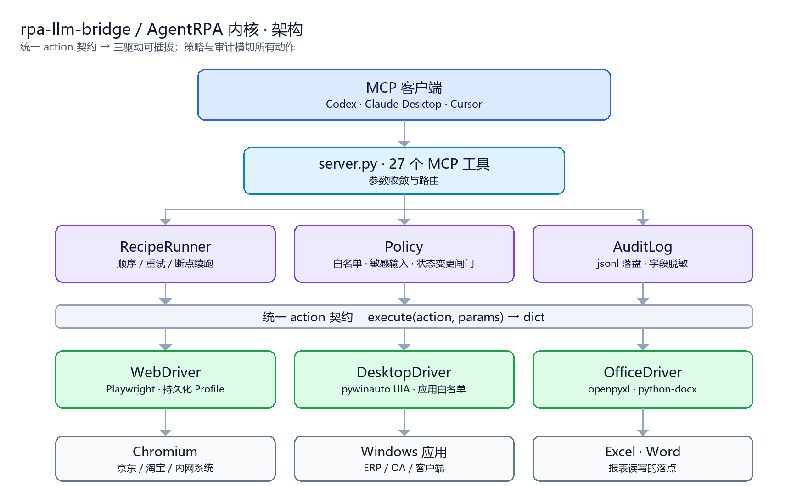
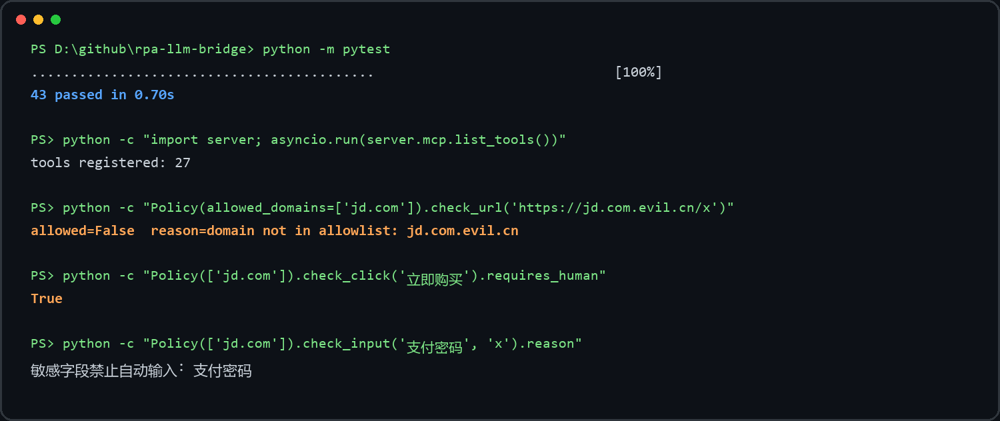

<p align="center">
  
</p>

# 把 LLM 接到 RPA 上

一套统一的 action 契约，同时驱动**浏览器、Windows 桌面应用和 Office 文件**；用 YAML 描述流程，用策略闸门管住不可逆动作，用审计日志留下每一步的痕迹。

通过 [MCP](https://modelcontextprotocol.io) 暴露给 Codex / Claude Desktop / Cursor，让模型能真正"操作"本机软件，而不是只会说。

[](https://github.com/c8xm/rpa-llm-bridge/actions/workflows/ci.yml)


---

## 为什么另做一套

多数 RPA 项目只覆盖一个网站、一种交互，逻辑写死在脚本里，安全边界散落在各处。真正把"让模型自动干活"落到生产时，卡住的从来不是"能不能点"，而是这四件事：

| 问题 | 常见做法 | 本项目的做法 |
|---|---|---|
| 换一个被控端就要重写 | 每个站一套脚本 | 统一 action 契约，新增驱动零改动 |
| 流程改一行要改代码 | 硬编码 | YAML Recipe，可 diff、可版本化、可参数化 |
| 误点"支付"无法挽回 | 靠自觉 | 集中式策略闸门 + 人工确认 + 断点续跑 |
| 出事后无法复盘 | 打日志了事 | 结构化审计 jsonl，敏感字段强制脱敏 |

## 架构：三个抽象，一条契约

<p align="center">
  
</p>

### Driver — 唯一需要为"新被控端"写的东西

```python
async def execute(self, action: str, params: dict) -> Any
```

`RecipeRunner` 不认识 Playwright，也不认识 pywinauto。它只知道 action 名和参数。新增一种被控端 = 新增一个 `BaseDriver` 子类 + 注册进 `drivers` 字典。

### Recipe — 把流程变成可 review 的文件

```yaml
name: ecom_collect
driver: browser
vars:
  search_url: "https://search.jd.com/Search?keyword=机械键盘"
steps:
  - id: open
    action: navigate
    url: "{{search_url}}"
  - id: settle
    action: wait
    ms: 1500
  - id: cards
    action: extract
    multi:
      titles: ".gl-item .p-name a"
      prices: ".gl-item .p-price strong"
    limit: 30
  - id: submit
    action: click
    ref: e2
    label: 提交订单
    hitl: true          # 不可逆动作，必须人工确认
    on_error: abort     # abort | skip | retry
```

### Policy — 唯一的判定点

浏览器那边拦了"购买"、桌面那边忘了拦"结算"、Office 那边根本没这个概念——这是早期最典型的漏洞。现在任何驱动执行前都要过同一套判定：

| 检查项 | 方法 | 默认行为 |
|---|---|---|
| 域名白名单 | `check_url()` | 仅 `ALLOWED_DOMAINS` 内可访问，含同形域名拦截 |
| 应用白名单 | `check_app()` | `ALLOWED_APPS` 为空时拒绝启动任何桌面程序 |
| 敏感输入 | `check_input()` | 密码 / 验证码 / OTP / 卡号 / CVV 一律拒绝 |
| 状态变更 | `check_click()` | 购买、支付、下单、发布、删除 → 拦截并等待人工 |

### 断点续跑：人工闸门是状态机，不是弹窗

```text
running ──hitl / 策略拦截──▶ awaiting_human ──run_resume(approve)──▶ running ──▶ completed
```

暂停时把 `steps / index / results / vars` 整体写入 `artifacts/runs/<run_id>.json`。续跑从**暂停的那一步**开始执行（不是下一步），并带 `auto_approve` 标记，否则会立刻再次暂停。这个细节在 `test_hitl_pauses_then_resume_executes` 里被固定下来。

## 三个驱动，一张表

| 驱动 | 底层 | 能力 | 平台 |
|---|---|---|---|
| `browser` | Playwright | navigate / snapshot / elements / click / fill / press / scroll / back / screenshot / extract / wait | 全平台 |
| `desktop` | pywinauto (UIA) | launch / windows / focus / elements / click / fill / press / read | Windows |
| `office` | openpyxl · python-docx | sheets / read / write / append | 全平台 |

`browser` 的元素 ref 是**短生命周期**的：`list_page_elements` 会给元素打 `data-agentrpa-ref`，页面一导航就失效，必须重新获取。这是刻意的取舍——持久句柄会让模型拿着过期引用乱点，失败信息还很难解释。

## 上手：四条命令跑起来

```powershell
git clone https://github.com/c8xm/rpa-llm-bridge.git
cd rpa-llm-bridge
python -m venv .venv
.\.venv\Scripts\python.exe -m pip install -e ".[dev]"
.\.venv\Scripts\python.exe -m playwright install chromium
Copy-Item .env.example .env
.\.venv\Scripts\python.exe -m pytest      # 43 passed
```

桌面能力按需装：`pip install -e ".[desktop]"`；Office 能力：`pip install -e ".[office]"`。

### 接到你的客户端

```toml
[mcp_servers.rpa_llm_bridge]
command = "<PROJECT_DIR>/.venv/Scripts/python.exe"
args = ["<PROJECT_DIR>/server.py"]
cwd = "<PROJECT_DIR>"
enabled = true
startup_timeout_sec = 30
tool_timeout_sec = 180

[mcp_servers.rpa_llm_bridge.env]
PLAYWRIGHT_HEADLESS = "false"
ALLOW_STATE_CHANGING_ACTIONS = "false"
ALLOWED_DOMAINS = "jd.com,taobao.com,tmall.com"
```

## 内置流程：五个场景

| Recipe | 场景 | 驱动 | 关键点 |
|---|---|---|---|
| `ecom_collect` | 电商信息采集 | browser | 抓标题与价格，保留页面快照 |
| `web_form` | 通用网页表单 | browser | 填普通字段，提交前强制人工确认 |
| `desktop_erp` | 桌面 ERP 录入 | desktop | 启动客户端、定位窗口、填单据、读回显 |
| `office_report` | 企业报表 | office | 读源表 → 写汇总表 |
| `social_publish` | 内容平台运营 | browser | 填草稿、截图预览，发布动作人工确认 |

## 27 个 MCP 工具

| 分组 | 工具 |
|---|---|
| 信息 | `server_info` `policy_summary` `driver_status` |
| 浏览器生命周期 | `browser_start` `browser_status` `browser_close` |
| 页面操作 | `open_url` `page_snapshot` `list_page_elements` `click_page_element` `type_into_element` `scroll_page` `take_screenshot` `extract_page` |
| 流程编排 | `recipe_list` `recipe_get` `recipe_run` `run_state` `run_resume` `run_list` |
| 审计 | `audit_tail` |
| 桌面 | `desktop_windows` `desktop_focus` `desktop_elements` |
| Office | `office_sheets` `office_read` `office_write` |

## 质量：不是"能跑"，是被断言过

<p align="center">
  
</p>

- **43 个单元测试**：策略（含同形域名、三种状态变更开关组合）、执行器（成功 / 失败中止 / 跳过 / 重试计数 / dry-run / 模板渲染 / 未知驱动 / 策略拦截 / 状态落盘）、Recipe（重复 id、非法 `on_error`、驱动继承）、审计（按 key 与 label 双重脱敏）、Office 驱动（写入 / 追加 / 读取 / 缺表缺文件）
- **测试不启动外部进程**，所以 CI 在 Linux 上也能全绿
- **CI 矩阵**：ubuntu + windows × Python 3.11 / 3.12，外加 ruff 语法检查与 wheel 构建
- **端到端验证**：`office_report` 流程实际跑通 `sheets → read → write`，产出汇总文件

## 安全边界（写在代码里，不是写在文档里）

1. 不向页面注入反检测脚本，不伪造浏览器指纹
2. 不绕过验证码、滑块、短信验证——登录类步骤必须人工完成
3. 审计日志默认脱敏，`password` / `token` / `cookie` / `card` 等 key 与敏感 label 联动的 `text` 都不入库
4. `ALLOW_STATE_CHANGING_ACTIONS=true` 才会解锁下单 / 支付 / 发布，建议只在隔离环境打开
5. 本项目的定位是"替人做可解释的重复操作"，不是高频爬虫框架

## 已知限制

- 桌面驱动仅 Windows，依赖 UIA，部分老式 Win32 控件需要切 backend
- 元素 ref 短生命周期，点击或导航后必须重新获取
- Recipe 目前只支持顺序执行，条件分支与循环在路线图里
- Office 驱动走文件读写，不驱动已打开的 Excel 进程

## 路线图

- [ ] 多驱动混合流程（浏览器取数 → Excel 落表 → 桌面录入）
- [ ] Recipe 条件分支与循环
- [ ] 录制回放：把一次人工操作转成 Recipe 草稿
- [ ] 审计日志按 run 聚合查询与导出
- [ ] 桌面驱动的控件级截图对比回归

## 许可

MIT。架构思路上参考了 [JD-Taobao-MCP](https://github.com/HaonanYu123/JD-Taobao-MCP) 的人机协同与输出契约设计，代码为独立实现，差异记录见 `UPSTREAM.md`。

---

如果这个项目对你有用，点个 ⭐ 是最好的支持；有想法直接开 issue。
