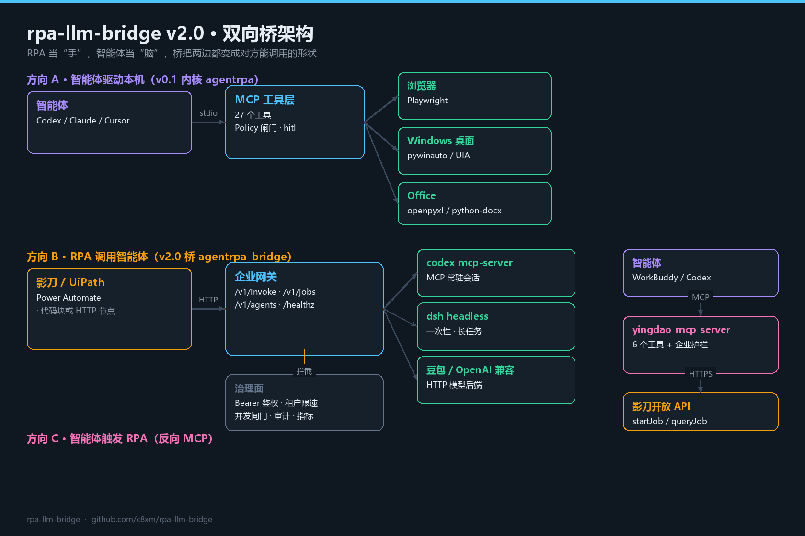
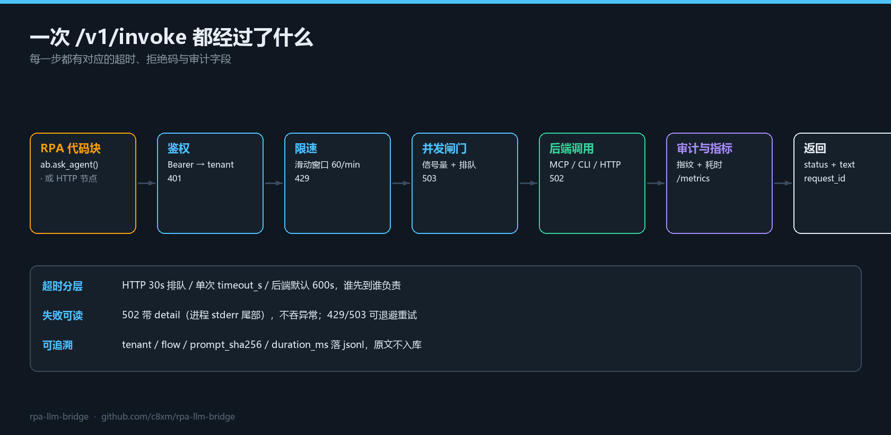
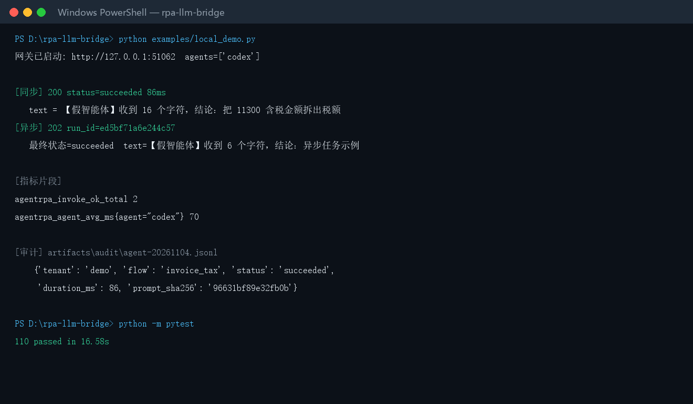
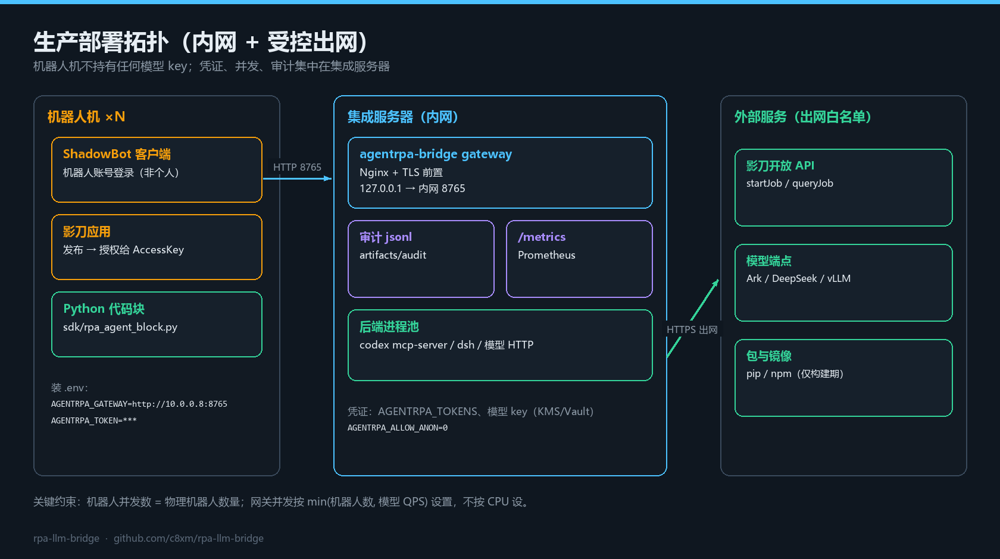

# v2.0.0 · 企业 RPA ⇄ 智能体 双向桥

> 发布日期：2026-11-04 · 上一个版本：v0.1.0
> 仓库：https://github.com/c8xm/rpa-llm-bridge · 文档：[USAGE](https://github.com/c8xm/rpa-llm-bridge/blob/main/docs/USAGE.md) · [PLATFORMS](https://github.com/c8xm/rpa-llm-bridge/blob/main/docs/PLATFORMS.md)

v0.1.0 解决的是**智能体驱动本机**：Codex / Claude 通过 MCP 点浏览器、点桌面、写 Office。
v2.0 补上企业里真正会买单的另一半：**RPA 反过来调用智能体**，以及**把 RPA 应用暴露成智能体的工具**。



---

## 一、这个版本解决什么

| 现状 | 问题 | v2.0 的答案 |
|---|---|---|
| 流程里直接调模型 API | key 散落在每台工位，离职就漏 | 网关一处托管，工位只有 token |
| 每个流程自己起一个 CLI | 每次冷启动 1–3 s，工具 schema 反复协商 | MCP 进程常驻、会话复用、空闲回收 |
| 没人管并发 | 一个死循环把订阅额度打穿 | 信号量 + 排队超时 503，按 tenant 限速 429 |
| 出问题靠人问 | 日志散在各工位，说不清算谁的 | 统一 jsonl：tenant / flow / 指纹 / 耗时 |
| 只想让助手"跑一下流程" | 助手碰不到企业内部系统 | 反向 MCP：影刀应用变成 6 个工具 |

---

## 二、新增能力

### 1. 企业网关 `agentrpa_bridge/gateway.py`

| 接口 | 用途 |
|---|---|
| `POST /v1/invoke` | 同步调用，返回 `{status, text, duration_ms, request_id}` |
| `POST /v1/jobs` + `GET /v1/jobs/{id}` | 异步任务，长流程用 |
| `GET /v1/agents` | 后端清单、工具名、会话冷热（`cold`/`alive`） |
| `GET /healthz` | 无需鉴权的存活探针 |
| `GET /metrics` | Prometheus 文本指标 |

一次调用要经过哪些关卡：



### 2. 四种后端形态 `agentrpa_bridge/providers.py`

| kind | 形态 | 已适配 | 单次耗时 |
|---|---|---|---|
| `mcp` | stdio MCP，进程常驻、会话复用 | `codex mcp-server`、`claude mcp serve`、自研 MCP | 3–15 s |
| `cli` | 一次性进程 | `dsh headless -`（DeepSeek Harness） | 冷启动 2–5 s + 任务 |
| `openai` | OpenAI 兼容 HTTP | 豆包/火山方舟、DeepSeek、vLLM、私有网关 | 1–8 s |

细节：工具名自动探测、`arg_template` 覆盖入参映射、进程崩溃自动重连一次、Windows `.cmd` shim 自动包 `cmd /c`。

### 3. 影刀 SDK `sdk/rpa_agent_block.py`

单文件、Python 3.8+、**零第三方依赖**，可直接粘进影刀 Python 代码块：

```python
import rpa_agent_block as ab
答案 = ab.ask_agent("发票号 123，价税合计 11300，只返回税额数字", agent="codex", timeout=180)
```

`AGENTRPA_GATEWAY` 有值走网关，没有就本地拉起 agent；长任务用 `ask_agent_async(prompt, callback=...)`。

### 4. 反向 MCP `agentrpa_bridge/yingdao_mcp_server.py`

`rpa_list_apps` / `rpa_app_params` / `rpa_start_job` / `rpa_query_job` / `rpa_clients` / `rpa_run_local`。
Codex、Claude Code、Cursor、WorkBuddy 都能用自然语言驱动影刀流程。

### 5. 配置导出 `scripts/export_mcp_config.py`

```powershell
python scripts\export_mcp_config.py --workbuddy   # 合并写 ~/.workbuddy/mcp.json，自动备份
python scripts\export_mcp_config.py --codex       # 打印 TOML 片段
```

---

## 三、详细部署步骤

### 步骤 0 · 前置检查

| 项 | 要求 | 检查命令 |
|---|---|---|
| Python | 3.11+（SDK 兼容 3.8+） | `python -V` |
| 系统 | Windows 10/11（桌面驱动与影刀客户端） | `winver` |
| 端口 | 8765 空闲 | `Test-NetConnection 127.0.0.1 -Port 8765` |
| 网络 | 能装 pip 包、能访问模型端点 | `curl -sI https://api.deepseek.com` |

### 步骤 1 · 获取代码并自检（不需要任何 API key）

```powershell
git clone https://github.com/c8xm/rpa-llm-bridge.git
cd rpa-llm-bridge
python -m unittest tests.test_mcp_client tests.test_providers tests.test_gateway `
                  tests.test_sdk tests.test_yingdao tests.test_platforms
python examples\local_demo.py
```

`local_demo.py` 的真实输出（同步 + 异步 + 指标 + 审计一次全跑）：



看到审计里只有 `prompt_sha256` 和截断输入、没有原文，说明脱敏生效。

### 步骤 2 · 配置环境变量

复制模板：

```powershell
Copy-Item .env.example .env
```

必改（网关）：

```ini
AGENTRPA_TOKENS=tenantA:tok-a,tenantB:tok-b
AGENTRPA_ALLOW_ANON=0
AGENTRPA_MAX_CONCURRENCY=4
AGENTRPA_RATE_LIMIT=60
AGENTRPA_AUDIT_DIR=artifacts/audit
```

按需选后端（可同时配）：

```ini
# Codex（推荐默认）
AGENTRPA_CODEX_CMD=codex
AGENTRPA_CODEX_ARGS=mcp-server

# DeepSeek Harness（长任务）
AGENTRPA_DSH_CMD=dsh
AGENTRPA_DSH_ARGS=headless -

# 豆包（火山方舟）：model 填接入点 id，不是模型名
AGENTRPA_DOUBAO_BASE=https://ark.cn-beijing.volces.com/api/v3
AGENTRPA_DOUBAO_MODEL=ep-20261104-xxxxxx
AGENTRPA_DOUBAO_KEY=<ARK_API_KEY>
```

### 步骤 3 · 启动网关

前台验证：

```powershell
python -m agentrpa_bridge.gateway --host 0.0.0.0 --port 8765
# agentrpa-bridge gateway on http://0.0.0.0:8765 (agents: codex, claude, dsh, doubao, llm)
```

注册成 Windows 服务：

```powershell
nssm install AgentRPABridge "C:\Python312\python.exe" "-m agentrpa_bridge.gateway --port 8765"
nssm set AgentRPABridge AppDirectory "D:\rpa-llm-bridge"
nssm set AgentRPABridge AppEnvironmentExtra "AGENTRPA_TOKENS=tenantA:tok-a" "AGENTRPA_ALLOW_ANON=0"
nssm set AgentRPABridge AppStdout "D:\rpa-llm-bridge\artifacts\gateway.log"
nssm start AgentRPABridge
```

无外网时用任务计划：`schtasks /create /tn AgentRPABridge /sc onstart /ru SYSTEM /tr "…python.exe -m agentrpa_bridge.gateway"`。
**服务账号不要用 SYSTEM 跑 agent**，给它专用低权账号与独立工作目录。

### 步骤 4 · 逐项验证

```powershell
curl -s http://127.0.0.1:8765/healthz
curl -s http://127.0.0.1:8765/v1/agents -H "Authorization: Bearer tok-a"
curl -s -X POST http://127.0.0.1:8765/v1/invoke `
  -H "Authorization: Bearer tok-a" -H "Content-Type: application/json" `
  -d '{"agent":"codex","prompt":"把 11300 含税金额按 13% 拆出税额，只返回数字","meta":{"flow":"invoice_tax"}}'
curl -s http://127.0.0.1:8765/metrics -H "Authorization: Bearer tok-a"
```

预期：`healthz` 返回 `status: ok`；`agents` 里每个后端的 `session` 显示 `cold` 或 `alive`；
`invoke` 返回 `status: succeeded` 与 `text`；`metrics` 出现 `agentrpa_invoke_ok_total`。

### 步骤 5 · 接入 RPA（以影刀为例）

**方式 A：Python 代码块**

1. 把 `sdk/rpa_agent_block.py` 复制到影刀 Python 模块目录。
2. 流程里写：

```python
import rpa_agent_block as ab

def main(发票号, 价税合计):
    答案 = ab.ask_agent(
        "发票号 %s，价税合计 %s 元（含 13%% 增值税）。只返回税额，两位小数。" % (发票号, 价税合计),
        agent="codex", timeout=180, meta={"flow": "invoice_tax", "batch": 发票号})
    return float(答案.strip())
```

3. 用影刀的异常处理块接住失败，走人工复核分支。

**方式 B：HTTP 请求节点**（不装 Python 包）

```
POST http://<gateway>:8765/v1/invoke
Authorization: Bearer <token>
Content-Type: application/json
{"agent":"codex","prompt":"……","timeout_s":180,"meta":{"flow":"invoice_tax"}}
```

长任务改 `/v1/jobs`，轮询间隔 ≥ 3 s。

### 步骤 6 · 反向：让智能体触发影刀

```powershell
$env:YINGDAO_ACCESS_KEY_ID="ak_xxx"; $env:YINGDAO_ACCESS_KEY_SECRET="sk_xxx"
python scripts\export_mcp_config.py --workbuddy     # 或 --claude / --cursor / --codex
python agentrpa_bridge\yingdao_mcp_server.py --selftest
```

没有影刀环境时，先用假开放 API 验证整条链路：

```powershell
python examples\reverse_demo.py
```

### 步骤 7 · 生产化收尾



- Nginx 前置 TLS + IP 白名单，`/metrics` 只对内网。
- Prometheus 抓 `/metrics`，告警看 `invoke_error_total` / `queue_timeout_total` / `rate_limited_total`。
- 回滚：把流程的 `agent` 改成 `llm`（纯模型兜底），RPA 侧零改动。

---

## 四、验证结果

```text
python -m pytest                 → 94 passed（内核 43 + 桥 51）
ruff check …                     → All checks passed
examples/local_demo.py           → 同步 200 / 异步 202→succeeded / 指标 / 审计
yingdao_mcp_server --selftest    → tools 6 个，openapi_configured=false（未配 key 时）
```

## 五、已知限制

1. **单个 agent 的并发 = 1**（一条 stdio 管道串行）；要并行请同名多实例或多节点。
2. `claude mcp serve` 暴露的是 Claude Code 的工具集合（Bash/Edit/…），**不是一次性问答**。
3. MCP 只实现 `initialize / tools/list / tools/call / ping`；`resources`、`prompts`、远程 OAuth 未做。
4. 影刀开放 API 的路径与签名按公开资料写默认值，`DEFAULT_PATHS` 与 `sign()` 两处可替换。
5. WorkBuddy 目前没有稳定的公开 Agent 调用 API，只能作为 MCP 客户端使用。
6. 流式输出未做（SSE 在路线图）。

## 六、升级 / 回滚

v0.1.0 → v2.0.0 是纯增量：

```powershell
git pull
.\.venv\Scripts\python.exe -m pip install -e ".[dev]"   # 拿新入口 agentrpa-gateway / agentrpa-rpa-mcp
python -m pytest
```

回滚：`git checkout v0.1.0`，v0.1 的内核与工具层未做任何改动。

---

MIT © 2026 c8xm
