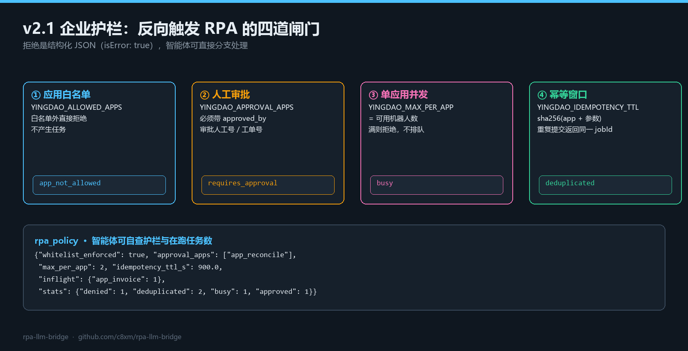
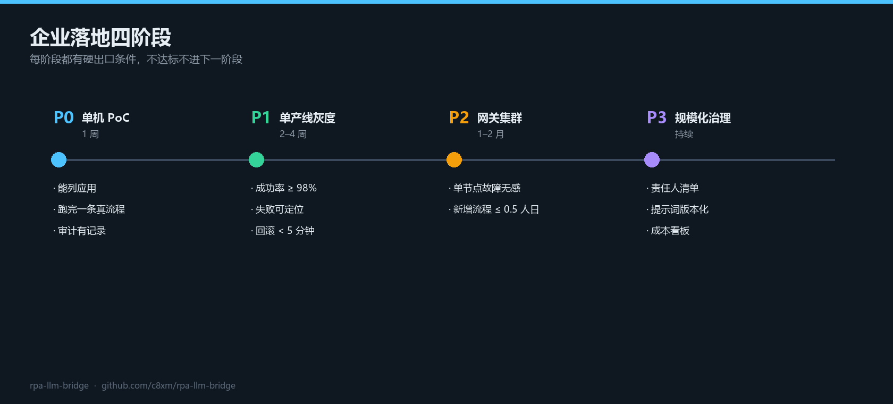

# v2.1.0 · 企业护栏与接入方案

> 发布日期：2026-11-04 · 上一个版本：[v2.0.0](https://github.com/c8xm/rpa-llm-bridge/releases/tag/v2.0.0)
> 完整方案：[ENTERPRISE-ADOPTION.md](https://github.com/c8xm/rpa-llm-bridge/blob/main/docs/ENTERPRISE-ADOPTION.md) · 使用说明：[USAGE.md](https://github.com/c8xm/rpa-llm-bridge/blob/main/docs/USAGE.md)

v2.0 解决了"能不能接"。v2.1 解决"敢不敢在生产接"：**给反向触发 RPA 的动作加上白名单、审批、并发、幂等四道闸门**，并补一份可直接拿去评审的企业接入方案。



---

## 一、为什么需要护栏

反向触发企业 RPA 属于**对内部系统的写操作**，比模型调用更危险：

| 风险 | 后果 | 对应护栏 |
|---|---|---|
| 助手"顺手"跑了没授权的流程 | 碰了不该碰的系统 | 应用白名单 |
| 涉及付款/对外发送的流程被自动触发 | 钱或信誉损失 | 人工审批（`approved_by`） |
| 多个会话同时开同一个应用 | 机器人排队、互相踩踏 | 单应用并发上限 |
| 同一张单被重复提交 | 重复下载/重复发送 | 幂等窗口 |

这四条不是"建议"，是**默认拒绝、显式放行**。

---

## 二、四道闸门

| ① 应用白名单 | ② 人工审批 | ③ 单应用并发 | ④ 幂等窗口 |
|---|---|---|---|
| `YINGDAO_ALLOWED_APPS` | `YINGDAO_APPROVAL_APPS` | `YINGDAO_MAX_PER_APP` | `YINGDAO_IDEMPOTENCY_TTL` |
| 白名单外直接拒绝，不产生任务 | 必须带 `approved_by`（工号/工单号） | 满则拒绝，不排队堆积 | 同参重复提交返回同一 `jobId` |
| 拒绝码 `app_not_allowed` | 拒绝码 `requires_approval` | 拒绝码 `busy` | 标记 `deduplicated: true` |

实现细节：

- **槽位随任务终态释放**：`rpa_query_job` 观察到 `success/failed/cancelled/...` 才归还并发名额，不会因为没人轮询而永久占用。
- **幂等键 = `sha256(app_id + 规范化参数)`**：参数顺序不影响结果；窗口过期自动失效。
- **拒绝是结构化 JSON**（`isError: true`），智能体可直接分支，不需要解析自然语言：

```json
{"error": "app_not_allowed", "allowed": ["app_invoice", "app_reconcile"]}
{"error": "requires_approval", "message": "应用 app_reconcile 属于审批清单，必须提供 approved_by…"}
{"error": "busy", "app_id": "app_invoice", "limit": 2}
```

- 空白名单 = 开发模式放行；生产必须显式填。

新增工具 `rpa_policy`，智能体可自查护栏与在跑任务数：

```json
{"whitelist_enforced": true, "allowed_apps": ["app_invoice", "app_reconcile"],
 "approval_apps": ["app_reconcile"], "max_per_app": 2, "idempotency_ttl_s": 900.0,
 "inflight": {"app_invoice": 1},
 "stats": {"denied": 1, "deduplicated": 2, "busy": 1, "approved": 1}}
```

---

## 三、部署步骤（在 v2.0 基础上增量）

### 步骤 1 · 升级代码

```powershell
cd D:\rpa-llm-bridge
git pull
git describe --tags            # 期望：v2.1.0
python -m pytest               # 期望：110 passed
```

### 步骤 2 · 配置四道闸门

写在**反向 MCP 进程**的环境里（不是网关进程）：

```powershell
$env:YINGDAO_API_BASE          = "https://api.yingdao.com"
$env:YINGDAO_ACCESS_KEY_ID     = "ak_xxx"
$env:YINGDAO_ACCESS_KEY_SECRET = "sk_xxx"

# ① 白名单：只放已评审的应用
$env:YINGDAO_ALLOWED_APPS      = "app_invoice,app_reconcile"
# ② 审批：涉及资金/对外发送的流程
$env:YINGDAO_APPROVAL_APPS     = "app_reconcile"
# ③ 并发：等于该应用可用机器人数
$env:YINGDAO_MAX_PER_APP       = "2"
# ④ 幂等：窗口秒数
$env:YINGDAO_IDEMPOTENCY_TTL   = "900"
```

或写进 Codex / WorkBuddy 的 `mcpServers.<name>.env`（`export_mcp_config.py` 生成后可手工追加）。

### 步骤 3 · 自检

```powershell
python agentrpa_bridge\yingdao_mcp_server.py --selftest
```

期望输出（注意 `policy` 段）：

```json
{"tools": ["rpa_list_apps", "rpa_app_params", "rpa_start_job",
           "rpa_query_job", "rpa_clients", "rpa_policy"],
 "openapi_configured": true, "local_available": false,
 "policy": {"whitelist_enforced": true, "allowed_apps": ["app_invoice", "app_reconcile"],
            "approval_apps": ["app_reconcile"], "max_per_app": 2,
            "idempotency_ttl_s": 900.0, "inflight": {},
            "stats": {"denied": 0, "deduplicated": 0, "busy": 0, "approved": 0}}}
```

### 步骤 4 · 逐条验证护栏

没有真影刀也能全验（假开放 API 与真接口同构）：

```powershell
python -m pytest tests/test_rpa_guard.py -v
```

手工验证四个拒绝码：

| 场景 | 调用 | 期望 |
|---|---|---|
| 白名单外 | `rpa_start_job app_id=app_ghost` | `app_not_allowed` |
| 审批缺失 | `rpa_start_job app_id=app_reconcile` | `requires_approval` |
| 审批放行 | 同上 + `approved_by="工单-88123"` | 返回 `jobId` |
| 重复提交 | 同参数再发一次 | `deduplicated: true`，同一 `jobId` |
| 并发打满 | 换参数再发（上限 2） | 第 3 个返回 `busy` |
| 槽位释放 | 轮询该 job 到 `success` | `rpa_policy.inflight` 变空 |

### 步骤 5 · 网关侧配套（不放宽）

护栏不等于全部，网关仍然要：

```ini
AGENTRPA_ALLOW_ANON=0
AGENTRPA_TOKENS=tenantA:tok-a
AGENTRPA_MAX_CONCURRENCY=min(机器人数, 模型QPS)
AGENTRPA_RATE_LIMIT=60
```

### 步骤 6 · 灰度与回滚

1. 先只开白名单，观察 `stats.denied` 是否为 0（不为 0 说明有流程在打白名单外的应用）。
2. 再加审批清单，把 `approved_by` 接进工单系统（工单号即审批凭证）。
3. 并发上限按机器人数量设，`busy` 出现说明该扩机器人或排队提示要前置到业务侧。
4. 回滚：删掉对应环境变量即回到 v2.0 行为（开发模式），不需要改代码。

---

## 四、企业落地路径



| 阶段 | 周期 | 出口条件 |
|---|---|---|
| P0 单机 PoC | 1 周 | 能列应用、跑完一条真流程、审计有记录、失败可读 |
| P1 单产线灰度 | 2–4 周 | 连续 2 周成功率 ≥ 98%、失败 100% 可定位、回滚 < 5 分钟 |
| P2 网关集群 | 1–2 月 | 单节点故障业务无感、新增流程 ≤ 0.5 人日 |
| P3 规模化治理 | 持续 | 流程责任人清单、提示词版本化、成本看板 |

完整版（角色分工、三种拓扑、评审必答 10 题、验收清单、常见否决理由与应对）见
[ENTERPRISE-ADOPTION.md](https://github.com/c8xm/rpa-llm-bridge/blob/main/docs/ENTERPRISE-ADOPTION.md)。

其中最关键的一句：**agent 只产出建议值，不可逆动作仍在影刀既有审批节点执行。**

---

## 五、修复

- `RpaGuard` 内部锁改为 `RLock`：`acquire()` 持锁时调用统计自增会自锁，导致 MCP 调用挂死（测试暴露后修正）。

## 六、验证结果

```text
python -m pytest                              → 110 passed（内核 43 + 桥 51 + 反方向 5 + 护栏 11）
tests/test_rpa_guard.py                       → 11 例：白名单 / 审批 / 幂等过期 / 并发 / 槽位释放
yingdao_mcp_server --selftest                 → 含 policy 快照
ruff check … --select E9,F63,F7,F82           → All checks passed
```

## 七、兼容性

- **纯增量**：v2.0 的环境变量与接口全部不变。
- 不配 `YINGDAO_*` 护栏变量时，行为与 v2.0 一致（开发模式放行）。
- 升级：`git pull` 即可，无需重装依赖。

---

MIT © 2026 c8xm
