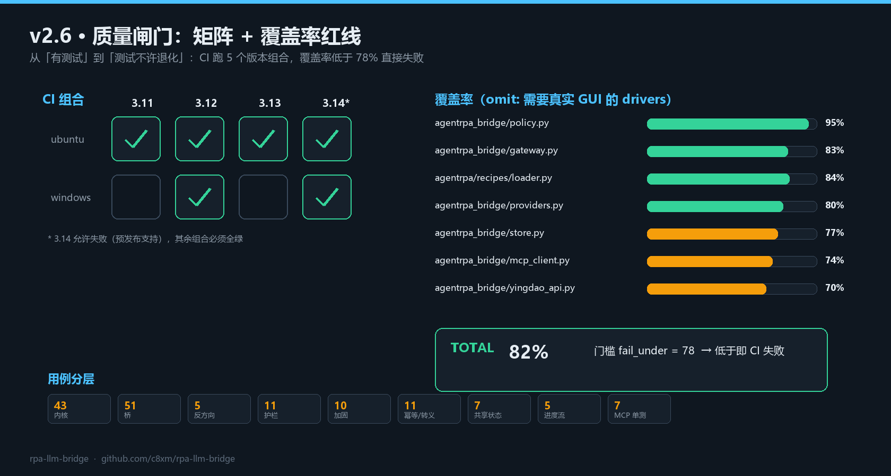

# v2.6.0 · 质量闸门：覆盖率高线 + CI 矩阵

> 发布日期：2026-11-05 · 上一个版本：[v2.5.0](https://github.com/c8xm/rpa-llm-bridge/releases/tag/v2.5.0)
>
> 从这一版开始，测试不只是"有"，而是"不许退化"：覆盖率跌破 78% 直接 CI 失败。



---

## 一、为什么加这道闸

v2.2 那轮自审发现 5 个边界 bug，全都是"代码能跑、测试没覆盖"造成的。用例数量从 110 涨到 143，但**没有任何机制阻止下一个人让它掉回去**——这就是覆盖率门槛要解决的问题。

## 二、做了什么

### 1. 覆盖率门槛

```toml
[tool.coverage.run]
source = ["agentrpa", "agentrpa_bridge"]
omit = ["agentrpa/drivers/*"]        # 需要真实浏览器/桌面，CI 跑不了

[tool.coverage.report]
fail_under = 78
```

```
TOTAL   1838 语句  331 未覆盖  82%
Required test coverage of 78.0% reached.
```

当前 82%，门槛 78%，留 4 个点给跨平台差异。分模块：

| 模块 | 覆盖率 |
|---|---|
| `agentrpa_bridge/policy.py` | 95% |
| `agentrpa/recipes/loader.py` | 84% |
| `agentrpa_bridge/gateway.py` | 83% |
| `agentrpa_bridge/providers.py` | 80% |
| `agentrpa_bridge/store.py` | 77% |
| `agentrpa_bridge/mcp_client.py` | 74% |
| `agentrpa_bridge/yingdao_api.py` | 70% |

### 2. CI 矩阵

| 组合 | 策略 |
|---|---|
| ubuntu × 3.11 / 3.12 / 3.13 | 必须全绿 |
| windows × 3.12 | 必须全绿（`.cmd` 转义、路径分隔符只有 Windows 能验） |
| ubuntu × 3.14 | 单列一档，`continue-on-error`：失败可见但不挡合并 |

每档都跑：`pytest --cov --cov-report=term` → 覆盖率不达标直接红；再跑 `examples/local_demo.py` 确认零依赖路径没坏。

### 3. lint 从"查语法"升级到"查全部"

以前只跑 `--select E9,F63,F7,F82`（等价于只查能不能 import）。现在 `ruff check .` 全量，配 `per-file-ignores` 处理测试的 `sys.path` 导入顺序。

### 4. 补了 7 个进程内单测

`tests/test_mcp_server_unit.py`：把 `RpaTools` 的 `list / params / start / query / policy / _job_id` 在进程内跑一遍。之前这个模块只有子进程集成测试，覆盖率统计不到（显示 0%），现在 83%。

顺带删掉 `agentrpa/core/registry.py`——从未被 `server.py` 引用过的死代码。

## 三、部署与验证

```powershell
git pull
.\.venv\Scripts\python.exe -m pip install pytest-cov -i https://pypi.tuna.tsinghua.edu.cn/simple
.\.venv\Scripts\python.exe -m pytest --cov --cov-report=term
```

期望输出：

```
TOTAL     1838    331     82%
Required test coverage of 78.0% reached. Total coverage: 81.99%
144 passed, 1 skipped
```

若你本地没装 `openpyxl`，会少跑 6 个 office 用例（`144 passed, 1 skipped`）；装了是 `150 passed`。

CI 侧无需改动：workflow 已经装 `pytest-cov` 并带上 `--cov`。

## 四、踩到的坑

`--omit` 参数用命令行传时被 PowerShell 吞掉了引号，`pytest-cov` 报 `unrecognized arguments`。改成写在 `pyproject.toml` 里之后跨平台稳定——这也是为什么配置进文件而不是塞进命令行。

## 五、还欠的

| 项 | 说明 |
|---|---|
| Redis 后端 | store 接口已就位，多机部署才需要 |
| 事件持久化 | 作业事件只在内存，重启不可回放 |
| 前端覆盖率 | 目前只统计 Python；没有前端代码，暂无缺口 |

---

MIT © 2026 c8xm
