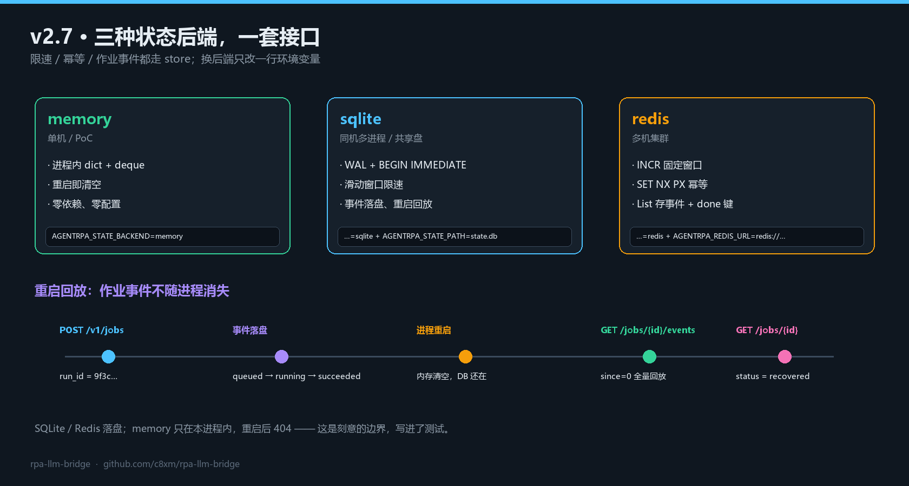

# v2.7.0 · Redis 后端 + 作业事件持久化

> 发布日期：2026-11-05 · 上一个版本：[v2.6.0](https://github.com/c8xm/rpa-llm-bridge/releases/tag/v2.6.0)
>
> 补齐最后两块：**状态不再只活在一台机器/一个进程里**，进度也能**跨重启回放**。



---

## 一、Redis 后端（零第三方依赖）

`store.py` 现在有三种实现，接口完全一致：

| 后端 | 限速 | 幂等 | 作业事件 | 适用 |
|---|---|---|---|---|
| `memory` | 滑动窗口（进程内） | 进程内 dict | 仅本进程 | 单机 / PoC |
| `sqlite` | 滑动窗口（WAL + `BEGIN IMMEDIATE`） | 表 + 事务 | 落盘 | 同机多进程、共享盘 |
| `redis` | 固定窗口（`INCR` + `PEXPIRE`） | `SET NX PX` | List + done 键 | 多机集群 |

```powershell
$env:AGENTRPA_STATE_BACKEND = "redis"
$env:AGENTRPA_REDIS_URL     = "redis://10.0.0.9:6379/0"   # 支持 rediss:// 与密码
```

实现细节：

- **自己写的 RESP2 客户端**（`_Resp`），只实现用到的 12 个命令，不引 `redis` 依赖——和整个项目"桥侧零依赖"的原则一致。
- 限速用固定窗口而不是滑动窗口：`INCR` + 首次 `PEXPIRE`，一次往返且天然原子；代价是窗口边界可能有轻微突刺，文档里写明了。
- 幂等用 `SET key value NX PX ttl` 抢占：返回 `OK` 即 `new`，否则读值判断 `inflight` / `done`。
- 作业事件用 `RPUSH` + `LTRIM -200 -1`，终态再写 `job:{id}:done`，24 小时过期。

## 二、作业事件持久化

以前 SSE 的进度只存在网关内存里，进程一重启就没了。现在：

```text
POST /v1/jobs              → 事件逐条写进 store
（进程重启）
GET /v1/jobs/{id}/events   → 从 store 全量回放，since / Last-Event-ID 照常
GET /v1/jobs/{id}          → {"status": "recovered", "persisted": true, "events": [...]}
```

- `sqlite` / `redis` 落盘；`memory` 重启后仍是 404——这是刻意的边界，也写进了测试。
- 事件写失败不会拖垮调用链，只会计 `job_persist_errors_total`。

## 三、修掉的一个真 bug

第一版回放接上去之后，SSE 在**续传**时会一直发心跳、永远等不到 `end`：

```
GET /v1/jobs/{id}/events?since=4
→ 事件列表为空 + done=False → 每 10s 一个 ping，直到客户端超时
```

原因：`job_read(after)` 用"返回切片里的最后一条"判断 done，切片为空时 done 自然是 False。改成**看整体最后一条事件**（SQLite 单查一条，memory 记 done 集合，Redis 用 done 键）。这个 bug 只会在"已结束 + 带 since 重连"时出现，正是持久化要解决的场景，测试里一条用例锁死了它。

## 四、验证

```powershell
git pull
python -m pytest --cov --cov-report=term
```

```text
TOTAL     2028    347     83%
Required test coverage of 78.0% reached. Total coverage: 82.89%
154 passed, 1 skipped
```

新增 10 个用例：

| 文件 | 覆盖 |
|---|---|
| `tests/test_redis_store.py`（7） | 限速固定窗口、幂等生命周期、事件读写与 200 条裁剪、URL 解析、JSON 往返 |
| `tests/test_job_persistence.py`（3） | 重启后事件序列完全一致、`status=recovered`、`memory` 后端重启 404、`since` 续传 |

Redis 用例跑在自带的假 Redis 上（`tests/fake_redis.py`，RESP2，约 130 行），CI 不需要起真实 Redis。

## 五、升级

```powershell
git pull
python -m pytest          # 154 passed（装 openpyxl 后 160）
```

- 默认仍是 `memory`，行为与 v2.6 完全一致。
- 要跨机：`AGENTRPA_STATE_BACKEND=redis` + `AGENTRPA_REDIS_URL`。
- 要重启回放：`sqlite` 或 `redis` 即可，不需要改客户端。

## 六、现在的全景

```text
v0.1 内核     智能体 → 浏览器/桌面/Office，Policy + hitl + 断点续跑
v2.0 桥       RPA → 智能体，网关 + 影刀 SDK + 反向 MCP
v2.1 护栏     白名单 / 审批 / 单应用并发 / 幂等
v2.2 加固     鉴权 / 连接 / 锁 / 超时 / PII
v2.3 幂等     Idempotency-Key + .cmd 转义
v2.4 共享     sqlite 状态后端
v2.5 进度     SSE 事件流
v2.6 质量     覆盖率红线 + CI 矩阵
v2.7 扩展     redis 后端 + 事件持久化
```

---

MIT © 2026 c8xm
